# PcapHouse 🦈

**English** | [简体中文](./README.zh-CN.md)


> A home for your packet captures — upload, organize, search and inspect pcap
> files in the browser, with a Wireshark-powered viewer and a protocol-aware
> capture generator.

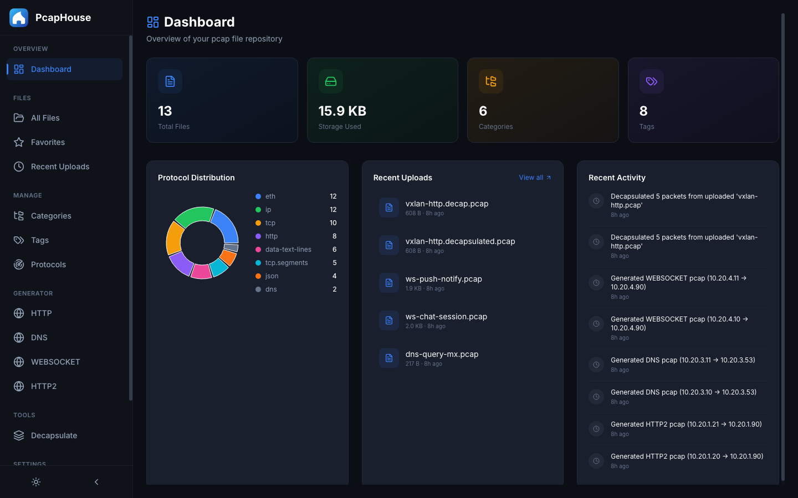

_Screenshots below show a demo library: 12 generated captures (HTTP/1.1,
HTTP/2, DNS, WebSocket) plus one decapsulated VXLAN capture. No real traffic._

## ⚠️ Security notice — read before deploying

**PcapHouse has no built-in authentication or access control.** Anyone who can
reach the web port can view, upload, download and delete every capture, and can
modify tags, categories and settings. Packet captures regularly contain
sensitive material — plaintext traffic, cookies, credentials, internal host
names.

Treat it as **trusted-network software**:

- Do **not** expose port 8080 directly to the public internet.
- For remote access, front it with a VPN, an SSH tunnel, or a reverse proxy
  that enforces authentication (basic auth, OAuth2 Proxy, Authelia, …).
- On shared or untrusted networks, keep it bound to localhost.

## Features

- 📁 **File management** — upload, download, rename and organize pcap/pcapng files
- 🏷️ **Tags & categories** — group captures your way
- ⭐ **Favorites** — star the captures that matter
- 🔍 **Search** — full-text search across files, tags and categories
- 🔬 **Pcap viewer** — inspect packet details in the browser via Wireshark Sharkd
- 📊 **Dashboard** — storage stats, protocol distribution, recent activity
- ⚙️ **Pcap generator** — synthesize realistic captures (HTTP/1.1, HTTP/2, DNS)
  by driving real client/server traffic over a loopback alias and capturing it
  with tcpdump + tcprewrite
- 🧅 **Decapsulate** — strip outer Geneve/VXLAN tunnel layers from a capture
- 🔗 **Share** — publish a capture and get a shareable download link
- 💾 **Scheduled backup** — back up the database and every capture

## Screenshots

### Dashboard & library

| Dashboard — storage stats, protocol distribution, recent activity | All files — search, filter by protocol/tag/category |
| --- | --- |
|  | 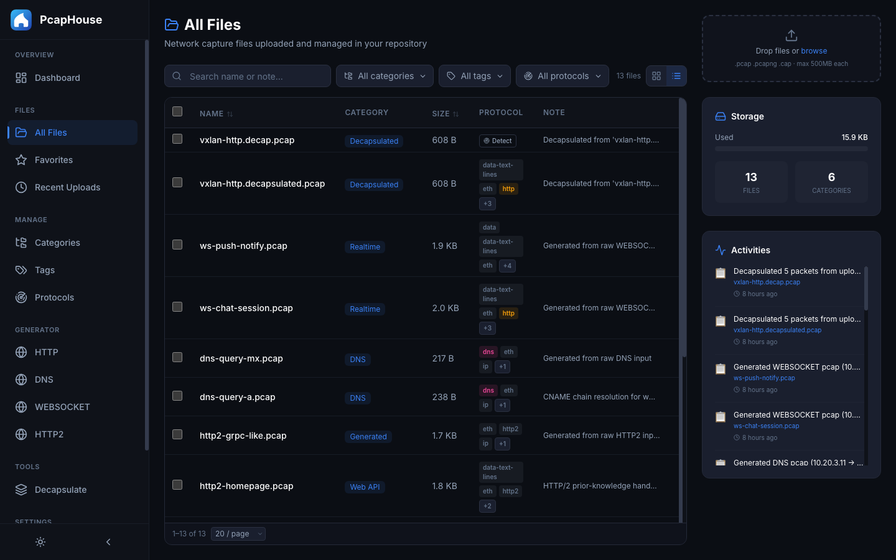 |

### Inspecting a capture

Powered by Wireshark Sharkd: packet list, protocol tree and hex dump in the
browser.

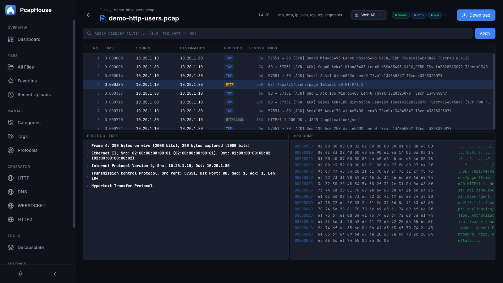

### Generating captures

Pick a protocol, paste a raw request/response (or a DNS answer set / WebSocket
frame list), then let the generator drive real traffic and capture it.

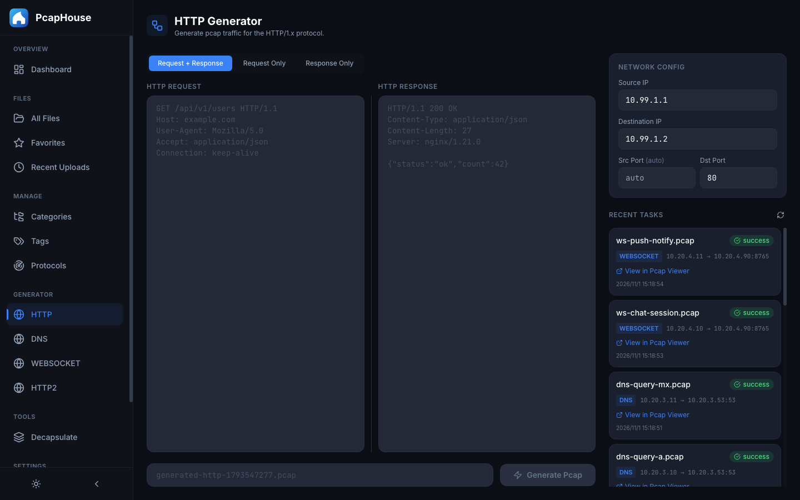

### Decapsulating tunnels

Strip Geneve/VXLAN from an uploaded capture — 5/5 packets decapsulated below —
and open the result straight in the viewer.

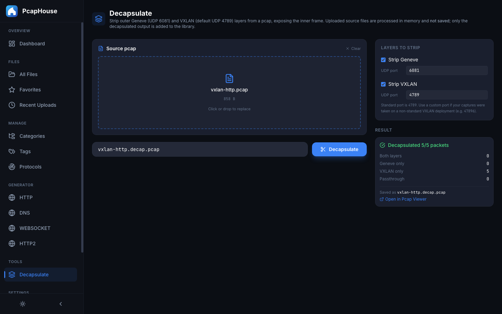

<details>
<summary>More: organize, favorites, recent, protocols, share, backup</summary>

| Categories & tags | Favourites |
| --- | --- |
| 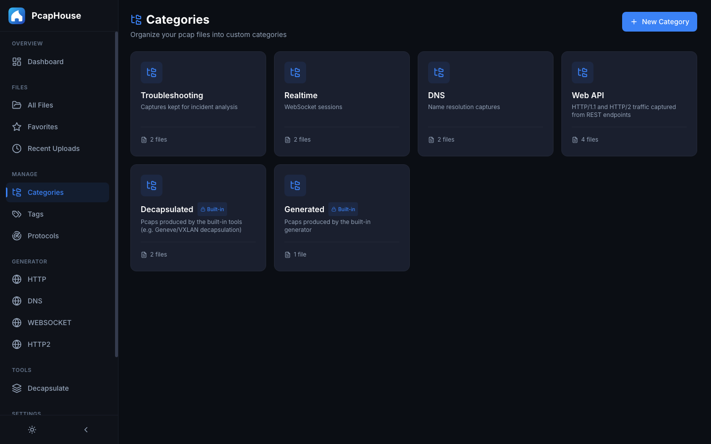 | 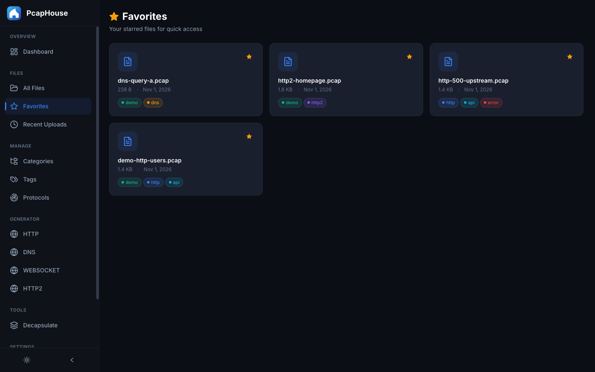 |

| Recent uploads | Decapsulated capture in the viewer |
| --- | --- |
| 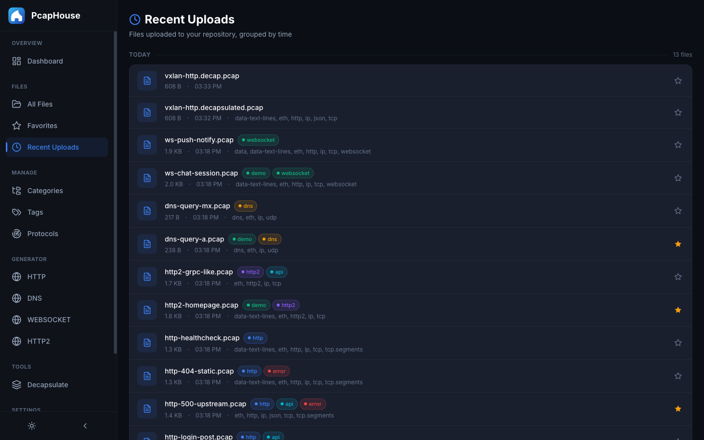 | 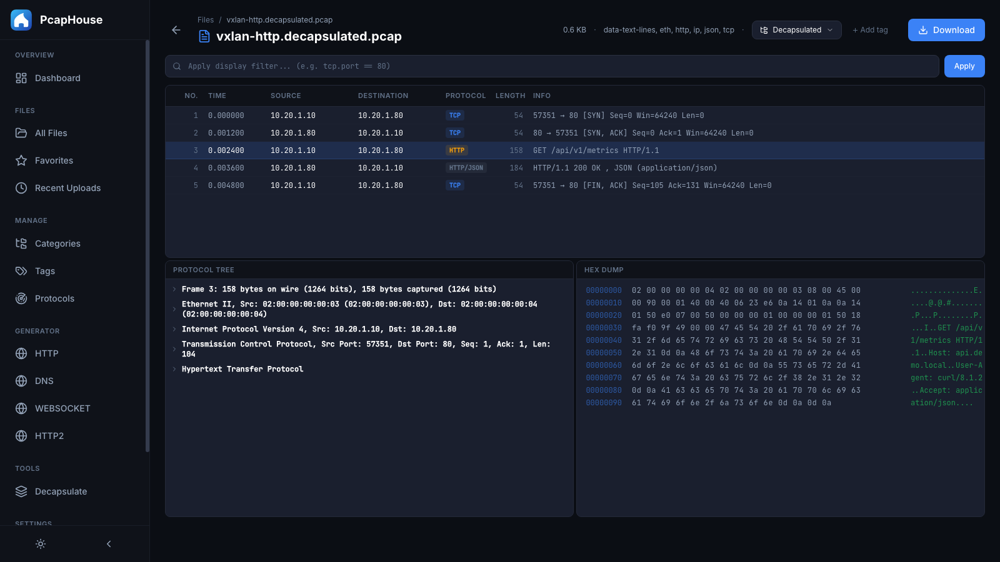 |

| Protocol catalogue — 3052 protocols, curate your defaults | Tags |
| --- | --- |
| 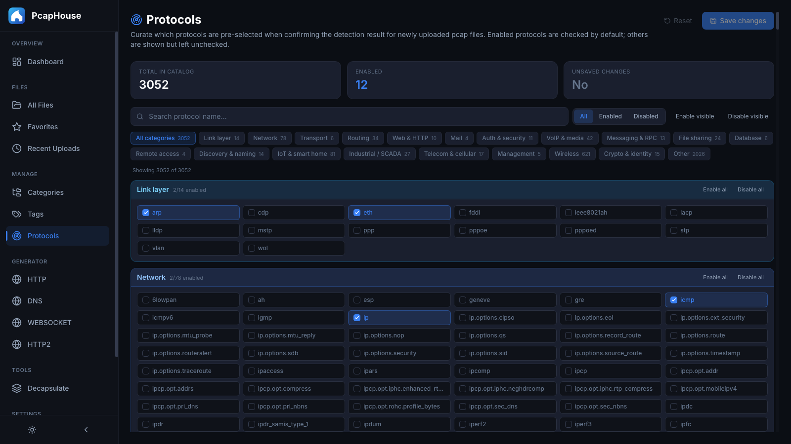 | 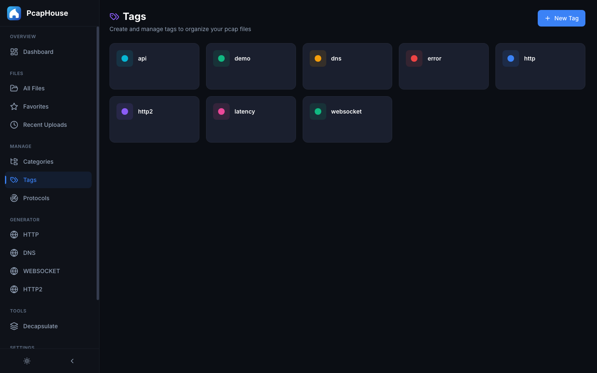 |

| Share via COS | Scheduled backup |
| --- | --- |
| 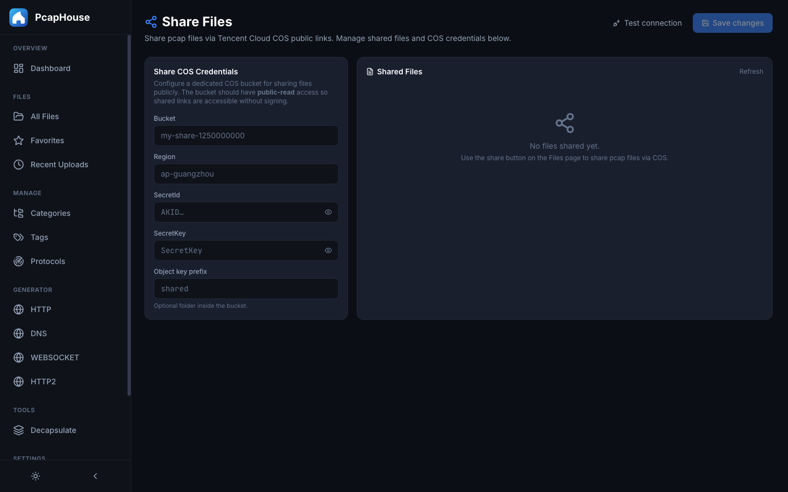 | 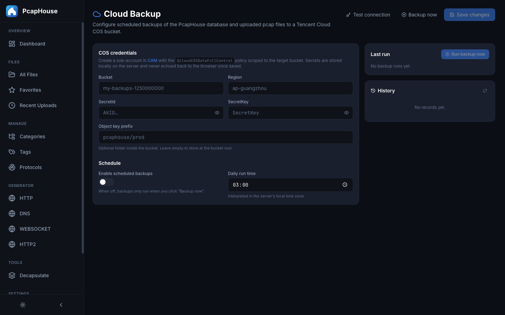 |

</details>

## Tech stack

| Layer | Technology |
| --- | --- |
| Frontend | React + TypeScript + Vite + Tailwind CSS |
| Backend | Python FastAPI + SQLAlchemy + SQLite |
| Pcap analysis | Wireshark Sharkd |
| Pcap generation | tcpdump + tcprewrite |
| Packaging | Single Docker image — nginx + uvicorn under supervisord |

## Quick start (Docker)

Requires Docker 20.10+ with the Compose plugin.

```bash
git clone https://github.com/ArrowQin/PcapHouse.git
cd PcapHouse
./pcaphouse.sh docker-up
```

Then open:

- Web UI → <http://localhost:8080>
- API docs → <http://localhost:8080/docs>

Day-to-day commands:

```bash
./pcaphouse.sh docker-status   # container state
./pcaphouse.sh docker-logs     # tail logs
./pcaphouse.sh docker-down     # stop (data preserved)
./pcaphouse.sh docker-upgrade  # git pull + rebuild + restart
```

### What runs inside

One container (`pcaphouse`) with supervisord managing two processes:

- `uvicorn` — FastAPI on `127.0.0.1:8000` (container-internal only)
- `nginx` — serves the Vite bundle on `:80` and reverse-proxies `/api`, `/docs`,
  `/redoc`, `/openapi.json` to uvicorn

The container needs `NET_ADMIN` + `NET_RAW` so the generator can add loopback
aliases and sniff. This is scoped to the container's network namespace — host
networking is unaffected.

### Persistent data

State lives in a host directory bind-mounted into the container, so you can
inspect and back it up with ordinary tools:

```
${PCAPHOUSE_DATA_DIR:-./data}/
├── db/       # SQLite database (+ WAL/SHM sidecars)
└── uploads/  # every uploaded and generated pcap
```

Copy `.env.example` to `.env` to move it or change the port:

```bash
PCAPHOUSE_DATA_DIR=/srv/pcaphouse
PCAPHOUSE_HTTP_PORT=18080
```

### Backup / restore

```bash
./pcaphouse.sh docker-down
tar czf pcaphouse-$(date +%F).tar.gz -C "${PCAPHOUSE_DATA_DIR:-./data}" .
./pcaphouse.sh docker-up
```

Restore onto a fresh host:

```bash
mkdir -p ./data && tar xzf pcaphouse-YYYY-MM-DD.tar.gz -C ./data
./pcaphouse.sh docker-up
```

## Local development

Requirements: Node.js 18+, Python 3.11+, Wireshark (for viewing), tcpdump and
tcpreplay (for the generator).

```bash
./pcaphouse.sh start    # frontend + backend, with hot reload
./pcaphouse.sh stop
./pcaphouse.sh status
./pcaphouse.sh db-reset
./pcaphouse.sh help     # full command list
```

The frontend runs at <http://localhost:5173> (Vite proxies `/api` to the
backend); the backend at <http://localhost:8000>.

The generator needs root for `tcpdump` and loopback aliases — on macOS either
run it via `sudo ./pcaphouse.sh start backend` or grant `NOPASSWD` sudoers
entries for `ifconfig` and `tcpdump`.

### Sharkd

Docker deployments bundle Sharkd. For local development install Wireshark:

```bash
brew install wireshark                       # macOS
sudo apt install tshark wireshark-common     # Debian/Ubuntu
```

Make sure `sharkd` is on your `$PATH`.

## API

Interactive Swagger docs are served at <http://localhost:8080/docs>
(<http://localhost:8000/docs> in local dev).

## Contributing

Issues and pull requests are welcome. Please describe the problem or use case
first — and for anything touching the pcap generator or the viewer, a small
sanitized sample capture speaks louder than prose.

## License

[MIT](./LICENSE) © 2026 ArrowQin
