# PcapHouse 🦈

[English](./README.md) | **简体中文**


> 你的抓包文件之家 —— 在浏览器里上传、整理、检索和查看 pcap 文件，
> 内置基于 Wireshark 的报文查看器和协议感知的抓包生成器。

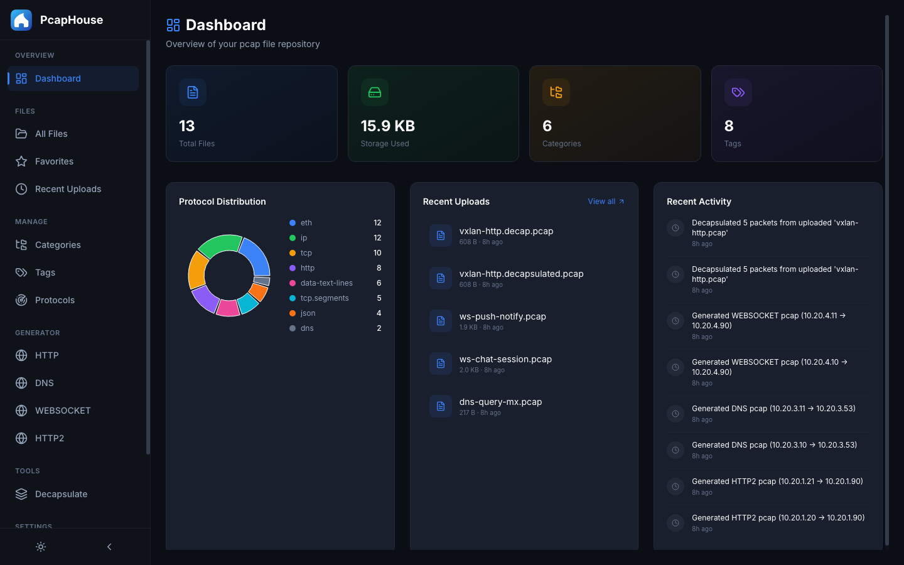

_以下截图为一个演示库：12 个生成的抓包（HTTP/1.1、HTTP/2、DNS、WebSocket）
加 1 个解封装后的 VXLAN 抓包，不含任何真实流量。_

## ⚠️ 安全须知 —— 部署前请务必阅读

**PcapHouse 没有内置任何身份认证或访问控制。** 任何能访问到服务端口的人，
都可以查看、上传、下载和删除全部抓包文件，也能修改标签、分类和配置。
而抓包文件通常包含敏感内容：明文流量、Cookie、凭据、内网主机名等。

请把它当作**仅限可信网络使用**的软件：

- **不要**把 8080 端口直接暴露到公网。
- 需要远程访问时，请在前面加一层 VPN、SSH 隧道，或带认证的反向代理
  （basic auth、OAuth2 Proxy、Authelia 等）。
- 在共享或不可信网络中，请只绑定到 localhost。

## 功能特性

- 📁 **文件管理** —— 上传、下载、重命名并组织 pcap/pcapng 文件
- 🏷️ **标签与分类** —— 按你自己的方式给抓包分组
- ⭐ **收藏** —— 标星重要抓包
- 🔍 **搜索** —— 跨文件名、标签、分类的全文检索
- 🔬 **抓包查看器** —— 通过 Wireshark Sharkd 在浏览器里查看报文细节
- 📊 **仪表盘** —— 存储统计、协议分布、最近活动
- ⚙️ **抓包生成器** —— 在 loopback 别名上驱动真实客户端/服务端流量并用
  tcpdump + tcprewrite 捕获，合成逼真的抓包（HTTP/1.1、HTTP/2、DNS）
- 🧅 **解封装** —— 剥离抓包外层的 Geneve/VXLAN 隧道封装
- 🔗 **分享** —— 发布抓包并生成可分享的下载链接
- 💾 **定时备份** —— 备份数据库和全部抓包文件

## 界面截图

### 仪表盘与文件库

| 仪表盘 —— 存储统计、协议分布、最近活动 | 全部文件 —— 搜索、按协议/标签/分类筛选 |
| --- | --- |
|  | 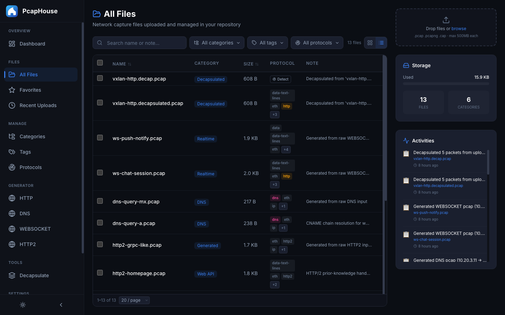 |

### 查看抓包

由 Wireshark Sharkd 驱动：浏览器里直接看报文列表、协议树和十六进制转储。

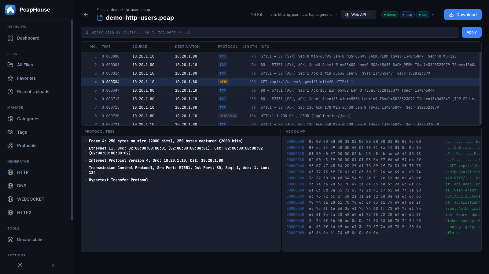

### 生成抓包

选择协议，粘贴原始请求/响应（或 DNS 应答集 / WebSocket 帧列表），
生成器会驱动真实流量并捕获下来。

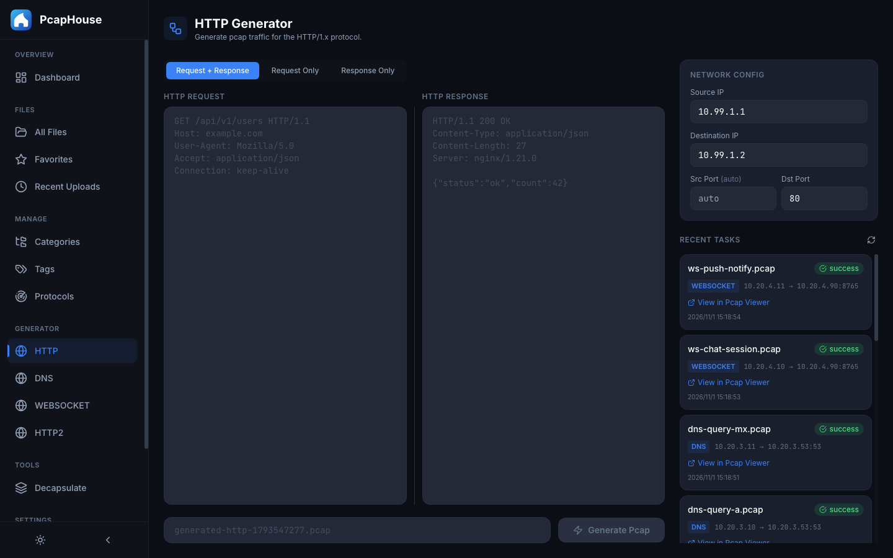

### 隧道解封装

剥离上传抓包外层的 Geneve/VXLAN —— 下图 5/5 个报文全部解封装完成 ——
并可直接在查看器中打开结果。

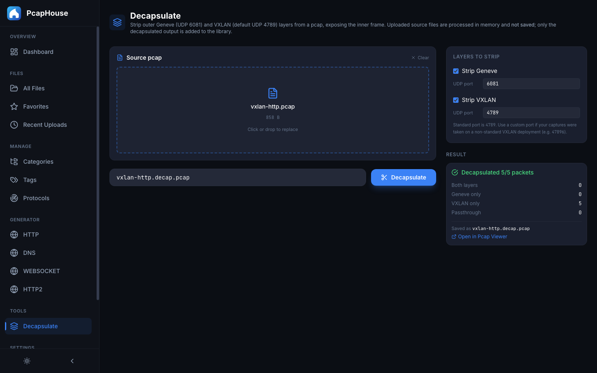

<details>
<summary>更多：整理、收藏、最近上传、协议、分享、备份</summary>

| 分类与标签 | 收藏 |
| --- | --- |
| 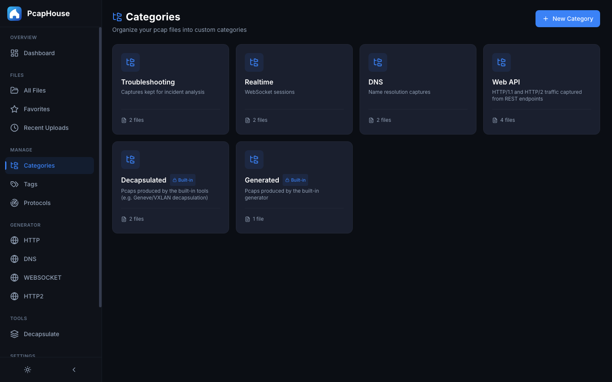 | 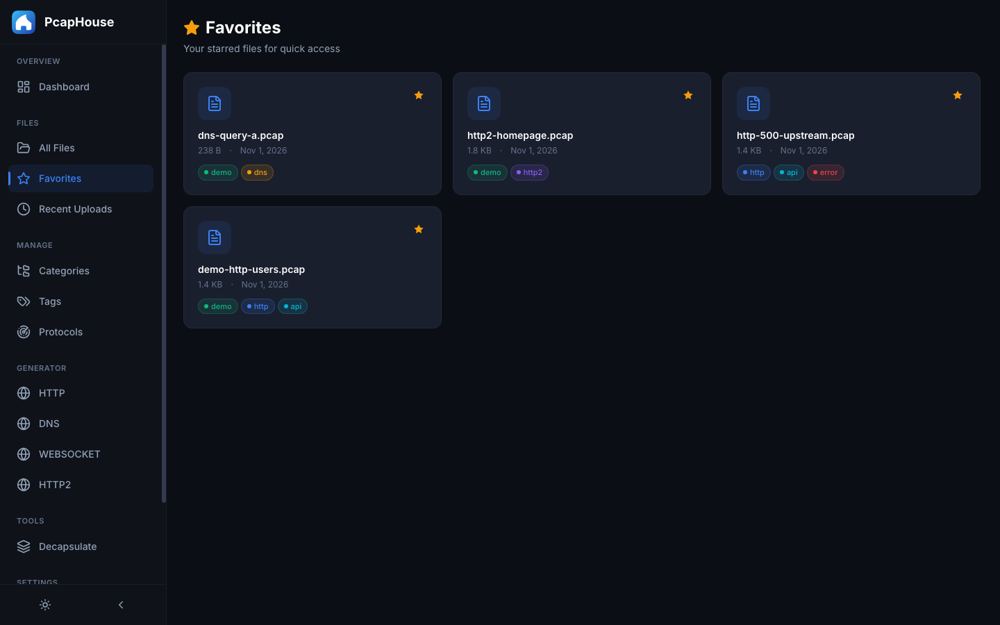 |

| 最近上传 | 查看解封装后的抓包 |
| --- | --- |
| 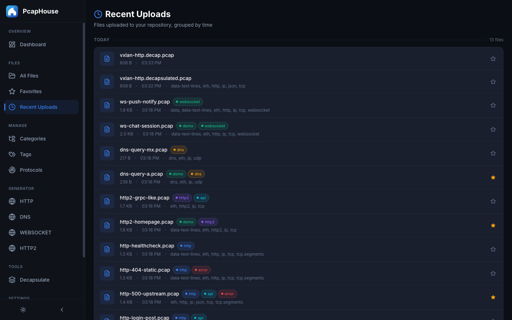 | 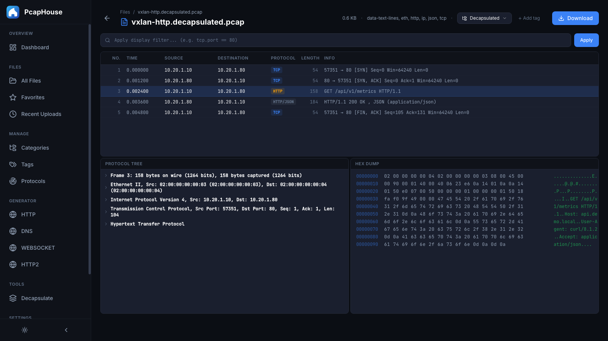 |

| 协议目录 —— 3052 个协议，可定制默认勾选 | 标签 |
| --- | --- |
| 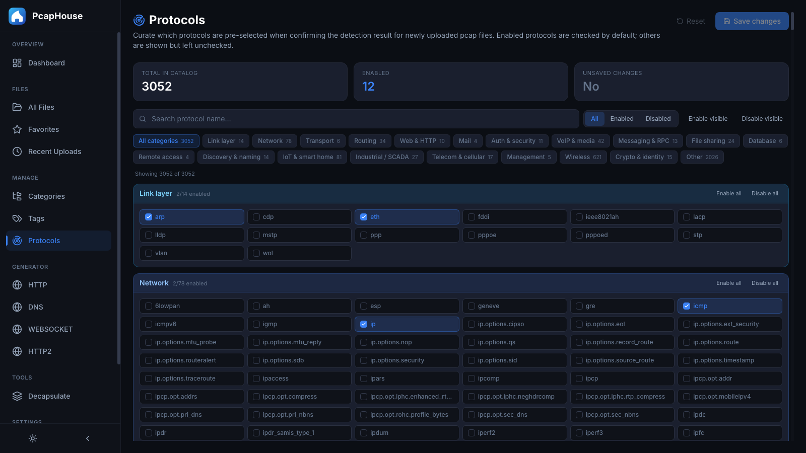 | 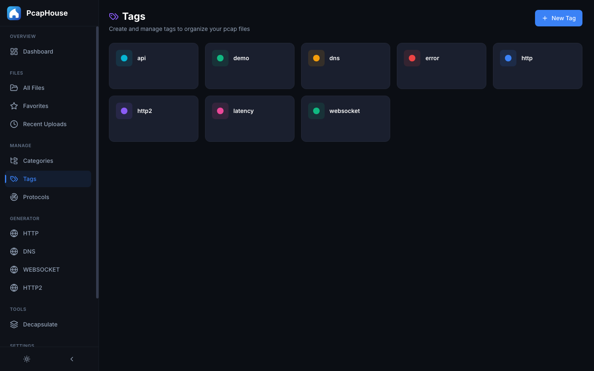 |

| 通过 COS 分享 | 定时备份 |
| --- | --- |
| 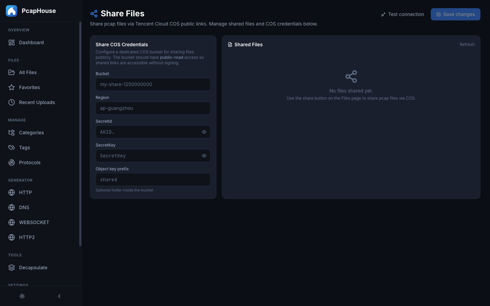 | 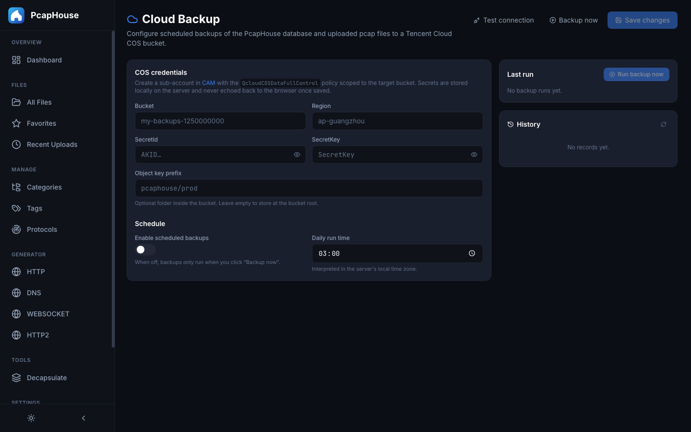 |

</details>

## 技术栈

| 层次 | 技术 |
| --- | --- |
| 前端 | React + TypeScript + Vite + Tailwind CSS |
| 后端 | Python FastAPI + SQLAlchemy + SQLite |
| 抓包分析 | Wireshark Sharkd |
| 抓包生成 | tcpdump + tcprewrite |
| 打包 | 单 Docker 镜像 —— nginx + uvicorn 由 supervisord 托管 |

## 快速开始（Docker）

需要 Docker 20.10+ 及 Compose 插件。

```bash
git clone https://github.com/ArrowQin/PcapHouse.git
cd PcapHouse
./pcaphouse.sh docker-up
```

然后打开：

- Web 界面 → <http://localhost:8080>
- API 文档 → <http://localhost:8080/docs>

常用命令：

```bash
./pcaphouse.sh docker-status   # 查看容器状态
./pcaphouse.sh docker-logs     # 跟踪日志
./pcaphouse.sh docker-down     # 停止（数据保留）
./pcaphouse.sh docker-upgrade  # git pull + 重新构建 + 重启
```

### 容器内部是什么

单个容器（`pcaphouse`）里由 supervisord 托管两个进程：

- `uvicorn` —— FastAPI 监听 `127.0.0.1:8000`（仅容器内可见）
- `nginx` —— 在 `:80` 提供 Vite 构建产物，并把 `/api`、`/docs`、`/redoc`、
  `/openapi.json` 反向代理给 uvicorn

容器需要 `NET_ADMIN` + `NET_RAW`，以便生成器添加 loopback 别名并抓包。
该能力仅限容器自身的网络命名空间，不影响宿主机网络。

### 持久化数据

状态存放在宿主机目录并 bind-mount 进容器，因此可以用常规工具直接查看和备份：

```
${PCAPHOUSE_DATA_DIR:-./data}/
├── db/       # SQLite 数据库（含 WAL/SHM 附属文件）
└── uploads/  # 所有上传和生成的 pcap
```

复制 `.env.example` 为 `.env` 可改变位置或端口：

```bash
PCAPHOUSE_DATA_DIR=/srv/pcaphouse
PCAPHOUSE_HTTP_PORT=18080
```

### 备份 / 恢复

```bash
./pcaphouse.sh docker-down
tar czf pcaphouse-$(date +%F).tar.gz -C "${PCAPHOUSE_DATA_DIR:-./data}" .
./pcaphouse.sh docker-up
```

在新机器上恢复：

```bash
mkdir -p ./data && tar xzf pcaphouse-YYYY-MM-DD.tar.gz -C ./data
./pcaphouse.sh docker-up
```

## 本地开发

依赖：Node.js 18+、Python 3.11+、Wireshark（用于查看）、tcpdump 与
tcpreplay（用于生成器）。

```bash
./pcaphouse.sh start    # 同时启动前后端，带热重载
./pcaphouse.sh stop
./pcaphouse.sh status
./pcaphouse.sh db-reset
./pcaphouse.sh help     # 完整命令列表
```

前端运行在 <http://localhost:5173>（Vite 会把 `/api` 代理到后端），
后端运行在 <http://localhost:8000>。

生成器需要 root 权限运行 `tcpdump` 和配置 loopback 别名 —— 在 macOS 上可以
用 `sudo ./pcaphouse.sh start backend`，或为 `ifconfig` 和 `tcpdump` 配置
`NOPASSWD` sudoers 规则。

### Sharkd

Docker 部署已内置 Sharkd。本地开发请安装 Wireshark：

```bash
brew install wireshark                       # macOS
sudo apt install tshark wireshark-common     # Debian/Ubuntu
```

并确保 `sharkd` 在你的 `$PATH` 中。

## API

交互式 Swagger 文档位于 <http://localhost:8080/docs>
（本地开发时为 <http://localhost:8000/docs>）。

## 参与贡献

欢迎提 issue 和 PR。请先描述问题或使用场景 —— 尤其是涉及抓包生成器或查看器
的改动，一份做过去敏处理的小样例抓包比大段文字更有说服力。

## 许可证

[MIT](./LICENSE) © 2026 ArrowQin
